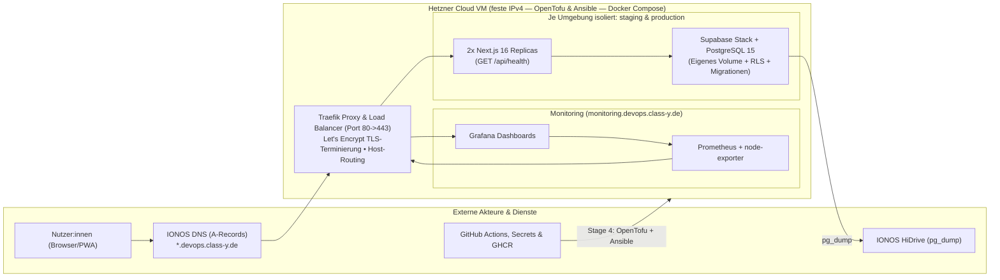
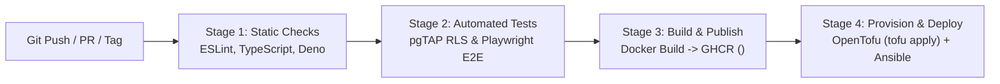

# Projektkonzept: Automatisierte Bereitstellung & Betrieb für `class-y`

- **Kurs:** DevOps – Software Development and Operations (WiSe 2026), BHT Berlin — **Milestone 1: Project Concept**
- **Anwendung & Repo:** `class-y` (PWA zur Kurserfassung & Studioverwaltung, AGPL-3.0) — https://github.com/ce-lona/class-y
- **Basis-Commit (Start DevOps-Modul):** [`ad34ef48c23e301d8f083020138a267c05e17f9d`](https://github.com/ce-lona/class-y/commit/ad34ef48c23e301d8f083020138a267c05e17f9d) | **Fork-Commit (`/api/health`, `Dockerfile`, CI):** [`b3e1df70d5a6ef50c1a6df2fbcdab83233750b83`](https://github.com/ce-lona/class-y/commit/b3e1df70d5a6ef50c1a6df2fbcdab83233750b83)

---

## 1. Zielanwendung, 3-Tier-Architektur & Umgebungen

`class-y` ist eine mandantenfähige Web-App/PWA für Fitnessstudios und Trainer:innen (`trainer`, `studio_admin`, `platform_admin`):
1. **Reverse Proxy & Load Balancer (`Traefik`):** Terminiert HTTPS (TLS 1.3 via Let's Encrypt), prüft `GET /api/health` und verteilt Traffic per Round-Robin auf **$\ge 2$ parallele Next.js-Container** (High Availability).
2. **Applikations- & API-Schicht:** Next.js 16 (`node` Standalone-Build, 2+ Replicas) + selbstgehosteter **Supabase-Stack** (API-Gateway, Auth, REST-API, Deno Edge Functions `invite-company-admin` & `invite-trainer`).
3. **Persistenz-Schicht (`PostgreSQL 15`):** Speichert alle relationalen Daten und erzwingt Mandantentrennung per Row Level Security (RLS).
- **Isolierte Umgebungen (`staging` & `production`):** Ab dem Fork-Commit `b3e1df7` laufen `staging` (`https://staging.devops.class-y.de`) und `production` (`https://devops.class-y.de`) strikt getrennt mit **jeweils eigener PostgreSQL-/Supabase-Instanz** und eigenem Docker-Volume.

---

## 2. Technologie-Auswahl & Begründung

| Bereich | Tool | Aufgabe & Begründung |
|---|---|---|
| **Infrastruktur (IaC)** | **OpenTofu** | Deklarative Allokation von Hetzner-VM, fester IPv4, SSH-Key & Firewall (Open-Source-Alternative zu Terraform, MPL-2.0). |
| **Konfiguration & Deploy** | **Ansible** | Idempotente Server-Einrichtung (SSH, Docker, Traefik, Monitoring) und `docker-compose`-Rollouts für `staging`/`production`. |
| **Container & Prozessmgmt.** | **Docker Compose + `systemd`** | Multi-Stage-Image (`node:22-alpine`). Prozessmanagement durch Docker (`restart: unless-stopped` + `HEALTHCHECK`) und `systemd` beim VM-Start; erfüllt HA ($\ge 2$ Replicas) ohne Kubernetes-Overhead. |
| **Reverse Proxy & TLS** | **Traefik** | Automatische Container-Erkennung via Docker-Labels, Let's-Encrypt-TLS-Terminierung & Health-Check-Load-Balancing (kein Reload wie bei NGINX). |
| **CI/CD & Registry** | **GitHub Actions + GHCR** | 4-stufige Pipeline (Checks $\to$ Tests $\to$ Build & Push $\to$ OpenTofu + Ansible) auf GitHub-hosted Runnern (`ubuntu-latest`); speichert **immutable Image-Tags (`<git-sha>`)** in der GHCR. |
| **Secrets & Persistenz** | **GitHub Secrets & `pg_dump`** | Keine Klartext-Secrets in Git; DB-Persistenz über isolierte Docker-Volumes + periodischer `pg_dump -Fc`-Backup-Job auf IONOS HiDrive. |
| **Monitoring** | **Prometheus + Grafana** | Selbstgehostet unter `https://monitoring.devops.class-y.de` für Host- (`node-exporter`) und HTTP-/Applikations-Metriken (`Traefik`). |

---

## 3. Automatisierung, CI/CD-Pipeline, Betrieb & Sicherheit

- **Automatisierte Provisionierung (Stage 4):** Die GitHub-Actions-Pipeline führt vor jedem Deploy `tofu apply -auto-approve` aus (legt beim Erstlauf Hetzner-VM, feste IPv4 und Firewall für Port `80/443/22` an; prüft danach idempotent den Zustand) und übergibt die IP an Ansible.
- **DNS & TLS-Terminierung:** Zwei IONOS-DNS-`A`-Records (`devops.class-y.de` & `*.devops.class-y.de`) zeigen auf die feste Hetzner-IPv4. Traefik terminiert TLS auf Port `443` (automatische Let's-Encrypt-Zertifikate, Redirect `80 -> 443`) und routet per `Host`-Header an `staging`, `production` oder `Grafana`.
- **Pipeline-Trigger (*Build once, deploy everywhere*):** Pull Requests führen Stage 1–3 als Quality-Gate aus. Pushes auf `main` bauen das Image mit **unveränderlichem Git-SHA-Tag** (`ghcr.io/ce-lona/class-y:<git-sha>`, kein `:latest`) und deployen auf `staging`. Ein Git-Tag (`v*.*.*`) rollt exakt dieses auf `staging` verifizierte Image auf `production` aus.
- **Zero-Downtime & Prozessmanagement:** Ansible startet beim Update erst 2 neue App-Container parallel zu den 2 laufenden. Erst wenn `GET /api/health` (prüft App + Supabase) `200 OK` (`healthy`) liefert, schaltet Traefik den Traffic um und stoppt die alten Container (bei Fehlschlag bleiben die alten Container aktiv). Abgestürzte Prozesse startet die Docker Engine (`restart: unless-stopped`) automatisch neu; den Docker-Daemon verwaltet `systemd`.
- **Überwachte Metriken (`Prometheus` + `Grafana`):**
  1. *Host (`node-exporter`):* CPU-Last (%), RAM (belegt/frei), Disk-Belegung & I/O der VM-/DB-Volumes, Netzwerk & Uptime.
  2. *HTTP & Latenz (`Traefik`, je Umgebung):* Requests/s (RPS), Antwortzeiten (p50/p95/p99), HTTP-Statuscodes (`2xx`/`4xx`/`5xx`).
  3. *Verfügbarkeit (`up` & `/api/health`):* Health-Status aller App-Replicas und der jeweiligen Supabase-/PostgreSQL-Instanz.
- **DevSecOps:** Alle Geheimnisse (`HCLOUD_TOKEN`, `SSH_PRIVATE_KEY`, DB-/JWT-Keys) liegen in **GitHub Secrets**; RLS wird in jedem CI-Lauf per `supabase test db` geprüft; DB-Ports (`5432`) sind nur im internen Docker-Netzwerk erreichbar; der App-Container läuft als Non-Root (`nextjs`).
